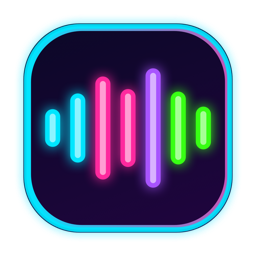

<p align="center">
  
</p>

<h1 align="center">Just Say It</h1>

<p align="center">
  <b>Free, unlimited, private voice typing and meeting notes for Mac and Windows.</b><br>
  Talk instead of type. Record any conversation. Get clean, ready-to-use text.<br><br>
  An original app designed and built by <b>Stefano Roman Gunness</b>
</p>

---

Just Say It turns your voice into polished text wherever your cursor is: Gmail, Outlook, Slack, Notion, ChatGPT, VS Code, anything. Hold a key, talk naturally, let go. Filler words disappear, punctuation is fixed, and the tone matches the app you're in.

Press **Right Shift three times** and the **Note Taker** records and transcribes a whole conversation or call, then turns it into structured meeting notes.

Everything runs **on your computer**. There's no account, no subscription, no word limit, and your voice never leaves your machine.

### Why I built it

I wanted one tool that does two things well: lets me *write by talking* anywhere on my computer, and *never take meeting notes by hand again*. I wanted it free, unlimited, private and on both Mac and Windows. Just Say It is my own design, from the hotkeys and the per-app tone system to the Note Taker, the calendar auto-join and the CollectivIQ hand-off. It's built entirely on the speech and AI engines that run on your own machine.

— Stefano Roman Gunness

**Contents:** [Features](#features) · [Requirements](#requirements) · [Install on Mac](#install-on-mac) · [Note Taker](#note-taker) · [Meetings](#meetings-auto-join-and-take-notes) · [Install on Windows](#install-on-windows) · [Updates](#updates) · [Privacy](#privacy) · [Build from source](#build-from-source) · [Author](#author)

## Features

- **Works in every app.** Text goes straight into the text box you're using. A result card also lets you edit, copy, or rewrite it.
- **Zero-edit dictation.** Removes "um", "uh", "like", repeated words and false starts, and adds punctuation and capitalization.
- **Self-corrections.** "Meet Tuesday, no wait, Wednesday" becomes "Meet Wednesday". Say **"scratch that"** to drop the last sentence.
- **Context aware.** Reads the app, the website (Gmail, ChatGPT, Slack…), the text you selected, the text already in the box and, optionally, what's on screen, so names are spelled right and the tone fits.
- **Tone per app.** Formal for email, relaxed for chat, exact words for AI prompts and code. Fully customizable.
- **Scribe mode.** Say rough notes ("tell him thanks, I'll send the file tomorrow") and get a complete, polished message.
- **Edit by voice.** Select text and say "make this shorter", "translate to Spanish" or "reply saying yes".
- **AI Rewrite.** One click to make text more formal, more casual, shorter, enthusiastic, longer, summarized, or grammar-fixed.
- **Lists.** Spoken lists become bullets or numbered lists.
- **Custom dictionary and auto-replace.** Names, brands, acronyms and jargon are always spelled the way you want.
- **Snippets.** Say a short phrase to insert an address, a link, or a signature.
- **Hotkeys.** Hold to talk, double-tap for hands-free, Shift for Scribe, Esc to cancel.
- **Many languages**, all processed on-device (40+ on Mac, ~100 with auto-detect on Windows).
- **Speak several languages without switching.** Pick up to four languages you speak (for example English and Spanish) and switch between them mid-sentence. Just Say It works out the language phrase by phrase, so you never have to say or change it.
- **Gets smarter as you use it.** Fix a word in the result card and it learns: after the same fix twice it's corrected automatically, names you fix are recognised next time, and it learns which languages you use most and how you write in each app. All on your computer.
- **Note Taker.** Press **Right Shift three times** to record and transcribe a conversation or call (you and the other side), with live transcript, speaker labels, automatic meeting notes and Markdown files. [More below](#note-taker).
- **Send to CollectivIQ.** After each recording, sends your own prompt + the full transcript to a new CollectivIQ chat inside the app (sign in once in the app's CollectivIQ window).
- **Records every live call automatically.** Join or answer a call in Microsoft Teams, Google Meet, Zoom, FaceTime, Cisco Webex, Slack Huddles, Discord, Skype, Whereby, Jitsi Meet, RingCentral (and RingCentral Video), GoTo Meeting, Zoho Meeting, Signal, WhatsApp and Telegram, in the app or in your browser, and the Note Taker records it until that call ends, then saves it and sends it to CollectivIQ straight away.
- **Auto-join meetings.** Connects to your **Google and Microsoft calendars**, joins your **Zoom, Google Meet and Teams** calls on time, and takes notes for each one automatically.
- **History and stats.** Words dictated, speaking speed, time saved. Stored only on your computer.

## Requirements

| | Mac | Windows |
|---|---|---|
| System | macOS 26 (Tahoe) or newer | Windows 10 (2004+) or Windows 11, 64-bit |
| Hardware | Apple silicon (M1 or newer) | Any modern PC; 8 GB RAM recommended |
| Speech engine | Apple on-device `SpeechAnalyzer` (built in) | OpenAI Whisper via whisper.cpp (downloaded once, offline after) |
| Smart AI (cleanup, Scribe, Rewrite, smart transcripts, meeting notes) | Apple Intelligence (built in) | **Built-in local AI** (Qwen 2.5 1.5B, downloaded by the installer, offline) |
| Note Taker: other side of calls | Screen Recording permission | Built in |

## Install on Mac

Open **Terminal** and paste:

```bash
curl -fsSL https://raw.githubusercontent.com/stefanoromang/just-say-it/main/install-mac.sh | zsh
```

Or download this repository and double-click `install-mac.sh` (or run `zsh install-mac.sh`).

The installer builds the app on your Mac and puts it in `~/Applications`. If Apple's free Command Line Tools aren't installed yet, it opens the installer for them; run it again afterwards.

### First launch (Mac)

1. Click the **waveform icon** in the menu bar → **Open Just Say It…**
2. Click **Fix** next to:
   - **Microphone:** to hear you
   - **Accessibility:** to type into other apps and use the hotkey
   - **Screen Recording** *(optional):* to read the email or chat you're replying to
3. Click into any text box, **hold Right ⌥ Option**, talk, and let go.

## How to use (Mac)

| Action | How |
|---|---|
| Dictate | Hold **Right ⌥**, talk, let go |
| Hands-free | Double-tap **Right ⌥**; tap again to finish |
| Scribe (notes → polished message) | Hold **⇧ Shift + Right ⌥** |
| Edit selected text by voice | Select text, hold **Right ⌥**, say "make this shorter" |
| Rewrite selected text | **⌃⌥R**, or menu bar → Rewrite |
| Drop the last sentence | Say **"scratch that"** |
| Line breaks | Say **"new line"** / **"new paragraph"** |
| Note Taker (record a conversation) | Press **Right ⇧ Shift three times**; again to stop |
| Cancel | **Esc** |
| Close the result card | **Esc** (from anywhere, no mouse needed) |

You can change the hotkey, languages, tones, dictionary and snippets in the app window.

### Speak in several languages

In **Settings › Languages you speak**, pick your main language and up to three more (for example **English** and **Spanish**). Just Say It listens in all of them at the same time and keeps, for each phrase, the language that heard it best – so "Hi Maria, I wanted to confirm Thursday… necesito que me envíes el presupuesto… thanks, talk soon" comes out right without switching anything. The Note Taker uses the same languages.

### Scribe: from what you say to a finished message

Hold **⇧ Shift + Right ⌥** and say what you want, like "tell Laura yes, we can move it to Tuesday at 10, the Madrid numbers are 48 thousand euros". Scribe first lists every point, name and number you said, then writes the message addressed to the right person (it reads the email or chat on screen to know who and what you're replying to), in the language of the conversation, and checks no number was lost. Choose its tone (Formal by default) in **Settings › Scribe tone**.

## Note Taker

### Teams / Google Meet captions and speaker names (optional)

Turn on **Add Teams / Meet captions** in the app menu or **Settings › Meeting intelligence**. Choose **Set up browser connector** and follow the included instructions to load the Chrome/Edge/Brave extension and register its native host. Show captions/transcription in your meeting, then click **Start capture** in the extension. Just Say It must be recording; its status changes from **Waiting** to **Connected** when text arrives.

This reads **visible Teams web / Google Meet captions**, not hidden or restricted meeting data. Organiser permissions and recording consent still apply. Names are supplied by the meeting platform, not verified identities. Capture cannot recover captions already gone from the page; website changes may require connector updates. For Teams desktop, use **Import meeting transcript** to add an authorised `.vtt`, `.srt` or UTF-8 `.txt` export while recording.

Platform text is saved in its own labelled section and included in smart notes/CollectivIQ delivery. Local audio remains a separate backup; overlapping statements can appear in both. Disabling the option stops new capture without deleting text already collected. The connector uses native messaging and local files, not an open network port. Live Teams/Meet compatibility needs real-meeting validation.

The Note Taker records and transcribes conversations, such as calls, interviews, stand-ups and client meetings, and turns them into notes you can use.

### Start and stop

| | Mac | Windows |
|---|---|---|
| Start / stop | Press **Right ⇧ Shift three times** quickly | Press **Right Shift three times** quickly |
| Also from | Menu bar → **Start Note Taker**, or the **Note Taker** page | Tray menu → **Start Note Taker**, or the **Note Taker** tab |
| Automatically | **Whenever a call starts in any supported call app**, and when a calendar meeting starts (see [Meetings](#meetings-auto-join-and-take-notes)) | Same |

Normal typing with Shift never triggers it: only three quick taps within about a second do, with no other keys pressed.

### What it captures

- **Me:** your microphone.
- **Others:** your computer's sound, which is the other people on Zoom, Google Meet, Teams or any call app. On Mac this needs the **Screen Recording** permission; on Windows it works without extra setup. You can turn it off in Settings.
- Every line is **timestamped** and labelled **Me** or **Others**.

### While you record

A small floating window shows the **live transcript**, a timer, and **Stop** and **Copy transcript** buttons, and a flashing **"JustSayIt - Note taker is active"** pill sits at the bottom of the screen. The menu-bar / tray icon turns **neon green**. You can keep working in any app.

### When you stop

1. **The transcript is finished** and saved.
2. **Meeting notes are written automatically:** Summary, Key points, Decisions and Action items (who → what → when). On Mac this uses Apple Intelligence; on Windows, the optional local Ollama model.
3. **Plain-text files are saved** in **Documents › Just Say It Notes**, named with the date and meeting title:
   - `… .txt`: summary, smart transcript and raw transcript together
   - `… - Raw.txt`: **exactly as heard**, with timestamps and speakers
   - `… - Smart.txt`: **words and logic fixed** so it reads clearly (same speakers and facts)

   The raw file is updated **while you talk**, so nothing is lost if your computer restarts.
4. **Optional:** the transcript is sent to **CollectivIQ** (see below). You choose **Smart**, **Raw** or **Both** each time.

All saved notes are listed on the **Note Taker** page, where you can open them or show them in Finder or Explorer.

### Send to CollectivIQ

After each recording, Just Say It can hand the transcript to **CollectivIQ**, inside the app with no browser needed:

1. On the **CollectivIQ** page (Mac) or in the **Note Taker** tab (Windows), click **Sign in to CollectivIQ** and sign in once with your own account. Tick **Remember me**.
2. Turn on **After each Note Taker recording, send my prompt + the transcript to CollectivIQ**.
3. When a recording stops, it's sent right away – no questions – following this rule, based on the DDRs you have in CollectivIQ:
   - **You have a DDR called Notetaker** → the **raw transcript** (exactly as heard) goes to it.
   - **No Notetaker DDR, but another DDR (your assistant)** → the **AI version** (your prompt + the transcript with words and logic fixed) goes to the first one.
   - **No DDR at all** → the **AI version** goes to a new **CIQ Chat**, answered by **Gemini** and **Nemotron**.

   Just Say It checks your DDRs every time it sends, so it adapts by itself when you add or remove one. The Notetaker name can be changed in the CollectivIQ settings.
4. A notification says your notes are **syncing and being processed inside CollectivIQ**, and another says when everything has been **sent**.

**Models and preview:** for CIQ Chat, Just Say It opens **All · Auto**, clicks **All Selected**, keeps only **Gemini** and **Nemotron** and clicks **Apply Changes**. With **Show a live preview while sending** on (the default) you can watch every step; turn it off to send invisibly.

The built-in prompt asks for a **16-section meeting analysis**: metadata, participants, how it started, the chronological flow, key points, decisions, open questions, risks, blockers, solutions, resolved issues, timelines, action items (Action → Owner → Due Date), key quotes, how it ended and an overall assessment. You can edit it, or click **Reset to the standard meeting prompt** to restore it. **Send my last note now** sends any saved note on demand.

### Privacy and consent

- Recording and transcription happen **on your computer**. Audio is never uploaded. The summary is written on your device. Only the text you choose to send goes to CollectivIQ.
- **Always tell people you're recording.** Recording laws differ by country and state; some require everyone's consent.

## Meetings: auto-join and take notes

### Every live call is recorded automatically

Join, answer or start a call in any of these apps and Just Say It **starts the Note Taker by itself**:

Microsoft Teams, Google Meet, Zoom, FaceTime, Cisco Webex, Slack Huddles, Discord, Skype, Whereby, Jitsi Meet, RingCentral (and RingCentral Video), GoTo Meeting, Zoho Meeting, Signal, WhatsApp and Telegram – the desktop apps, or the web versions in Chrome, Edge, Safari, Brave, Arc, Vivaldi, Opera or Firefox.

- **It keeps recording until that call ends.** Muting yourself, quiet moments, the calendar end time or another meeting starting never stop it. The call counts as ended when its app has used neither your microphone nor your speakers for 45 seconds.
- **Call running long and the next meeting starts?** The first recording keeps going (the next meeting is not recorded on top of it). Press **End Note Taker** in the Note Taker window, the menu bar / tray menu or Meetings settings to finish it.
- **Sent straight away.** When the call ends or you press End Note Taker, the notes are saved and sent to CollectivIQ immediately – no questions. Choose what (**Both**, **AI version** or **Raw**) and where (your **DDR** or **CIQ Chat**) once in the CollectivIQ settings.
- **As much detail as possible.** The raw transcript keeps every word with timestamps and speaker labels. The AI *smart transcript* fixes misheard words, grammar and broken sentences using the context of the whole conversation, and is checked to make sure no names, numbers or lines were dropped (if anything is lost, the original lines are kept).
- It reacts to **real calls only**: opening an app or having a tab open doesn't start a recording. Only a call using the microphone for a few seconds does.
- **On by default.** Change it in **Meetings › Record every live call automatically**, where you can turn each app on or off.
- On Mac, allow **Screen Recording** to capture the other people too; on Windows that works without extra setup.

### Join calendar meetings for you

Just Say It joins your calls **from your own computer**, using your own Zoom, Meet or Teams account. It doesn't send a bot. When a call starts:

1. It opens the meeting (Zoom straight in the Zoom app; Meet and Teams on their join screen).
2. It starts the Note Taker, records you and the other people, and stops when the meeting ends.
3. It saves a note named after the meeting, with the attendees, a summary, decisions and action items.

**Connect your calendars**

- **Mac:** add your Google and Microsoft (Outlook / Office 365 / Exchange) accounts in **System Settings › Internet Accounts** with Calendars turned on. Then open **Just Say It › Meetings**, click **Allow access**, and pick the calendars to watch.
- **Windows:** in **Just Say It › Meetings**, paste each calendar's private iCal link:
  - **Google Calendar:** Settings › *your calendar* › Integrate calendar › **Secret address in iCal format**
  - **Outlook / Microsoft 365:** Settings › Calendar › Shared calendars › **Publish a calendar** (Can view all details) › copy the **ICS** link

Then turn on **Join my calendar calls automatically**. The first time you join a Meet or Teams call, sign in and choose "remember me" so later calls connect straight away.

> Always tell the people in your meetings that you're taking notes.

## Install on Windows

**No administrator password needed.** Just Say It installs and runs for your Windows account only, so it works on work PCs and normal (non-admin) accounts.

**Easiest:** download **`JustSayIt-Setup-2.7.0.exe`** from the [latest release](https://github.com/stefanoromang/just-say-it/releases/latest) and run it. It installs to `%LOCALAPPDATA%\Programs\JustSayIt`.

**Or** open PowerShell and paste:

```powershell
irm https://raw.githubusercontent.com/stefanoromang/just-say-it/main/install-windows.ps1 | iex
```

(You can also download this repository and double-click `install-windows.cmd`.)

**If your PC blocks setup programs**, use the no-installer mode. It unzips the app into your user folder and adds shortcuts:

```powershell
& ([scriptblock]::Create((irm https://raw.githubusercontent.com/stefanoromang/just-say-it/main/install-windows.ps1))) -Portable
```

The one-line installer also switches to this mode by itself if the setup program is blocked. A **portable zip** is on the release page too.

### First launch (Windows)

1. Just Say It opens and downloads the speech model once (~470 MB). Look for its icon in the **system tray**.
2. Click into any text box, **hold Right Alt**, talk, and let go.
3. *(Optional)* Screen context is on by default: it reads the visible email or chat with Windows' offline OCR so names are spelled right. Turn it off in Settings if you prefer.

**Built-in local AI:** the installer downloads a small, fast AI model (Qwen 2.5 1.5B, about 1.1 GB) that runs **inside Just Say It on your PC**. No extra programs, no admin rights, works offline. It powers smart cleanup, Scribe, AI Rewrite, smart transcripts and meeting summaries. If the download is skipped or interrupted, the app finishes it on first launch. You can switch to *Better quality* (Llama 3.2 3B) in **Settings**. If you already use [Ollama](https://ollama.com), it's used as a fallback.

> Windows SmartScreen may warn about an unrecognized app because the installer isn't code-signed. Click **More info → Run anyway**.

### Windows hotkeys

| Action | How |
|---|---|
| Dictate | Hold **Right Alt**, talk, let go |
| Hands-free | Double-tap **Right Alt**; tap again to finish |
| Scribe | Hold **Shift + Right Alt** |
| Rewrite selected text | **Ctrl+Alt+R**, or tray menu → Rewrite |
| Note Taker (record a conversation) | Press **Right Shift three times**; again to stop |
| Cancel | **Esc** |

You can change the hotkey (Right Alt, Right Ctrl, F8 or Scroll Lock), speech model, language and AI model in **Settings**.

## The neon icon

The menu-bar icon (Mac) and tray icon (Windows) change color so you always know what Just Say It is doing:

| Color | Meaning | How |
|---|---|---|
| **Cyan** | Ready | — |
| **Pink** | Dictating | Hold the dictation key (one key) |
| **Purple** | Scribe | Shift + the dictation key (two keys) |
| **Green** | Note Taker recording | Right Shift three times |
| **Orange** | Working (polishing, sending) | — |

Active modes pulse. The colors are bright neon so they stand out on light and dark mode.

## Always running

- **Mac:** Just Say It starts automatically when you log in. Change it in **Settings › Start Just Say It when I log in**.
- **Windows:** it starts with Windows for your account, and is installed per user with no administrator password. Change it in **Settings › Start Just Say It with Windows**.

## Updates

Just Say It checks published releases at startup and daily while running—more than twice a week—and installs automatically after recording, transcription, dictation, open result cards and CollectivIQ sends finish. Mac builds the published tag; Windows validates the official download URL and SHA-256 digest. Missing checksums block automatic Windows installs. Checking/installation are independent options in **Settings › Updates**.

The app cannot check while closed or offline; it resumes when running again. Installation briefly restarts Mac/Windows. Debian may ask for your system password. Meeting caption capture still needs the optional connector's one-time setup.

## Debian / Linux preview

Download **`just-say-it_2.7.0_all.deb`** from the release and install with your package manager. Run `/usr/share/just-say-it/setup-speech.sh` once for local Whisper. Optional cleanup/Scribe uses separately installed local Ollama. See [linux/README.md](linux/README.md) for dependencies and limits.

This new preview is **not full Mac/Windows parity**: start/end recordings manually and use Copy. No automatic call detection, calendar joining, screen context, global hold key, automatic insertion or learned dictionary yet. Only Mac receives hands-on validation here; Debian source/package checks do not establish real desktop/audio compatibility.

## Privacy

> **Recording conversations:** the Note Taker records you and, optionally, your computer's audio. Always tell people when you're recording them; laws differ by country and state.

- **Mac:** speech by Apple's on-device `SpeechAnalyzer`; cleanup, Scribe and Rewrite by Apple's on-device Foundation Models; screen context read locally with Vision.
- **Windows:** speech by Whisper running locally (whisper.cpp); screen context by Windows' built-in offline OCR; smart features by the built-in local AI (llama.cpp), all on your PC. The only network use is the one-time model download.
- No servers, no analytics, no accounts. Settings and history stay on your computer (`~/Library/Application Support/JustSayIt` on Mac, `%LOCALAPPDATA%\JustSayIt` on Windows).

## Build from source

### Mac

```bash
git clone https://github.com/stefanoromang/just-say-it.git
cd just-say-it
./build-app.sh
```

The Mac app is plain Swift / SwiftUI with no third-party dependencies:

| File | What it does |
|---|---|
| `Sources/JustSayIt/App.swift` | Menu bar app and menu |
| `Sources/JustSayIt/MainView.swift` | Settings window |
| `Sources/JustSayIt/Controller.swift` | Record → clean up → insert flow |
| `Sources/JustSayIt/Transcriber.swift` | On-device speech recognition |
| `Sources/JustSayIt/TextBrain.swift` | Filler removal, corrections, tone, Scribe, Rewrite |
| `Sources/JustSayIt/LanguageMix.swift` | Picks the right language for each phrase when you mix languages |
| `Sources/JustSayIt/LearnCore.swift` / `Learner.swift` | Learns from your corrections, names, languages and style |
| `Sources/JustSayIt/Context.swift` | Reads app, website, selection and screen context |
| `Sources/JustSayIt/Inserter.swift` | Detects the app and pastes the text |
| `Sources/JustSayIt/ResultPanel.swift` | Result card (Insert / Copy / Rewrite) |
| `Sources/JustSayIt/Hotkeys.swift` | Hold, double-tap, Scribe and Esc hotkeys |
| `Sources/JustSayIt/Overlay.swift` | Floating recording pill |
| `Sources/JustSayIt/Store.swift` | Settings, dictionary, snippets, history |
| `Sources/JustSayIt/NoteTaker.swift` | Note Taker: recording, transcript, summary, files |
| `Sources/JustSayIt/NoteCapture.swift` | Long-form transcription and computer-audio capture |
| `Sources/JustSayIt/NoteWindow.swift` | Live Note Taker window |
| `Sources/JustSayIt/AutoJoin.swift` | Calendar watching, auto-join and automatic notes |
| `Sources/JustSayIt/CallWatcher.swift` | Detects live calls and records each one until it ends |
| `Sources/JustSayIt/CallApps.swift` | The supported call apps (apps, web addresses, window titles) |
| `Sources/JustSayIt/CIQSender.swift` | Sends transcripts to CollectivIQ in the background |
| `Sources/JustSayIt/StatusIcon.swift` | Neon menu-bar icon that changes color by mode |
| `Sources/JustSayIt/LoginItem.swift` | Starts the app when you log in |
| `Sources/JustSayIt/MeetingLinks.swift` | Finds Zoom / Meet / Teams links in calendar events |
| `Sources/JustSayIt/Updater.swift` | Checks GitHub for updates and installs them |

### Windows

Requires the [.NET 10 SDK](https://dotnet.microsoft.com/download):

```powershell
dotnet publish windows/JustSayIt/JustSayIt.csproj -c Release -r win-x64 --self-contained true -o windows/dist/JustSayIt
```

The installer is built with [Inno Setup](https://jrsoftware.org/isinfo.php) from `windows/installer/JustSayIt.iss`. GitHub Actions (`.github/workflows/windows.yml`) builds and publishes it automatically for every release.

The Windows app is C# / WinForms, using [Whisper.net](https://github.com/sandrohanea/whisper.net) and [NAudio](https://github.com/naudio/NAudio):

| File | What it does |
|---|---|
| `windows/JustSayIt/Program.cs` | Tray app, startup, About |
| `windows/JustSayIt/MainWindow.cs` | Settings window (tabs) |
| `windows/JustSayIt/Controller.cs` | Record → clean up → insert flow |
| `windows/JustSayIt/Transcriber.cs` | Microphone + on-device Whisper |
| `windows/JustSayIt/TextBrain.cs` | Filler removal, corrections, tone, Scribe, Rewrite |
| `windows/JustSayIt/LanguageMix.cs` | Splits speech into phrases and recognises each in its own language |
| `windows/JustSayIt/LearnCore.cs` / `Learner.cs` | Learns from your corrections, names, languages and style |
| `windows/JustSayIt/LocalAI.cs` | Built-in local AI (llama.cpp), model download and verification |
| `windows/JustSayIt/Context.cs` | Reads app, browser URL, selection and text box via UI Automation |
| `windows/JustSayIt/ScreenReader.cs` | Reads the visible window text with offline Windows OCR |
| `windows/JustSayIt/Inserter.cs` | Pastes into the focused text box |
| `windows/JustSayIt/Hotkeys.cs` | Global hold / double-tap / Scribe / Esc hotkeys |
| `windows/JustSayIt/Overlay.cs` | Floating recording pill |
| `windows/JustSayIt/ResultCard.cs` | Result card (Insert / Copy / Rewrite) |
| `windows/JustSayIt/Store.cs` | Settings, dictionary, snippets, history |
| `windows/JustSayIt/NoteTaker.cs` | Note Taker: mic + computer audio, chunked Whisper, summary, files |
| `windows/JustSayIt/NoteWindow.cs` | Live Note Taker window |
| `windows/JustSayIt/AutoJoin.cs` | Calendar (ICS) reading, auto-join and automatic notes |
| `windows/JustSayIt/CallWatcher.cs` | Detects live calls and records each one until it ends |
| `windows/JustSayIt/CallApps.cs` | The supported call apps (executables, window titles) |
| `windows/JustSayIt/TrayIcons.cs` | Neon tray icon that changes color by mode |
| `windows/JustSayIt/MeetingLinks.cs` | Finds Zoom / Meet / Teams links in calendar events |
| `windows/JustSayIt/Updater.cs` | Checks GitHub for updates and installs them (per-user) |
| `windows/JustSayIt/app.manifest` | Runs as the normal user (no admin prompt) |

## Tests

```bash
swift run RuleTests                                          # Mac text rules
dotnet test windows/JustSayIt.Tests/JustSayIt.Tests.csproj   # Windows text rules
```

On Windows you can also run a full end-to-end self-test of the real app: speech, context, screen reading, pasting and hotkey.

```powershell
JustSayIt.exe --selftest selftest-report.txt
```

All of these run automatically on GitHub for every change. The Windows self-test runs on a real Windows machine. See [CHANGELOG.md](CHANGELOG.md) for what's new.

## Uninstall

- **Mac:** `zsh uninstall-mac.sh`
- **Windows:** Settings → Apps → Installed apps → **Just Say It** → Uninstall

## Author

**Stefano Roman Gunness** conceived, designed and built Just Say It: the product idea, the features, the user experience and all of the app's code, on Mac and Windows.

## Built with

Just Say It is original software. It uses these platforms and open-source libraries under their own licenses:

- **Mac:** Apple's Speech (`SpeechAnalyzer`), Foundation Models (Apple Intelligence), Vision, ScreenCaptureKit, EventKit and WebKit frameworks.
- **Windows:** [LLamaSharp](https://github.com/SciSharp/LLamaSharp) / [llama.cpp](https://github.com/ggml-org/llama.cpp) (MIT) with [Qwen 2.5](https://huggingface.co/Qwen/Qwen2.5-1.5B-Instruct-GGUF) (Apache 2.0) or [Llama 3.2](https://huggingface.co/meta-llama/Llama-3.2-3B-Instruct) (Llama 3.2 Community License) models, [Whisper.net](https://github.com/sandrohanea/whisper.net) / [whisper.cpp](https://github.com/ggml-org/whisper.cpp) with OpenAI's Whisper models (MIT), [NAudio](https://github.com/naudio/NAudio) (MIT), [Ical.Net](https://github.com/ical-org/ical.net) (MIT), Microsoft WebView2, and Windows' built-in OCR and UI Automation. Optional local AI via [Ollama](https://ollama.com).
- **CollectivIQ** is a separate service with its own terms. You need your own CollectivIQ account to use that integration.

Zoom, Google Meet, Microsoft Teams, FaceTime, Webex, Slack, Discord, Skype, Whereby, Jitsi, RingCentral, GoTo, Zoho, Signal, WhatsApp, Telegram, Google Calendar and Outlook are trademarks of their respective owners. They're mentioned only to describe compatibility, and Just Say It isn't affiliated with or endorsed by them. Full details are in [NOTICE.md](NOTICE.md).

## License

[MIT](LICENSE) © 2026 Stefano Roman Gunness. You're free to use, modify and share it; please keep the copyright notice and credit the author.
