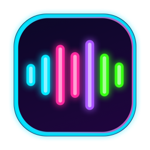

<p align="center">
  
</p>

<h1 align="center">Just Say It</h1>

<p align="center">
  <b>Free, unlimited, private voice typing for Mac and Windows.</b><br>
  Talk instead of type. Get clean, ready-to-send text in any app.<br><br>
  Created by <b>Stefano Roman Gunness</b>
</p>

---

Just Say It turns your voice into polished text wherever your cursor is: Gmail, Outlook, Slack, Notion, ChatGPT, VS Code, anything. Hold a key, talk naturally, let go. Filler words disappear, punctuation is fixed, and the tone matches the app you're in.

Everything runs **on your computer**. There's no account, no subscription, no word limit, and your voice never leaves your machine.

## Features

- **Works in every app.** Text goes straight into the text box you're using. A result card also lets you edit, copy, or rewrite it.
- **Zero-edit dictation.** Removes "um", "uh", "like", repeated words and false starts, and adds punctuation and capitalization.
- **Self-corrections.** "Meet Tuesday, no wait, Wednesday" becomes "Meet Wednesday". Say **"scratch that"** to drop the last sentence.
- **Context aware.** Reads the app, the website (Gmail, ChatGPT, Slack…), the text you selected, the text already in the box and, optionally, what's on screen, so names are spelled right and the tone fits.
- **Tone per app.** Formal for email, relaxed for chat, exact words for AI prompts and code. Fully customizable.
- **Scribe mode.** Say rough notes ("tell him thanks, I'll send the file tomorrow") and get a complete, polished message.
- **Edit by voice.** Select text and say "make this shorter", "translate to Spanish" or "reply saying yes".
- **AI Rewrite.** One click to make text more formal, more casual, shorter, enthusiastic, longer, summarized, or grammar-fixed.
- **Lists.** Spoken lists become bullets or numbered lists.
- **Custom dictionary and auto-replace.** Names, brands, acronyms and jargon are always spelled the way you want.
- **Snippets.** Say a short phrase to insert an address, a link, or a signature.
- **Hotkeys.** Hold to talk, double-tap for hands-free, Shift for Scribe, Esc to cancel.
- **Many languages**, all processed on-device (40+ on Mac, ~100 with auto-detect on Windows).
- **History and stats.** Words dictated, speaking speed, time saved. Stored only on your computer.

## Requirements

| | Mac | Windows |
|---|---|---|
| System | macOS 26 (Tahoe) or newer | Windows 10 (2004+) or Windows 11, 64-bit |
| Hardware | Apple silicon (M1 or newer) | Any modern PC; 8 GB RAM recommended |
| Speech engine | Apple on-device `SpeechAnalyzer` (built in) | OpenAI Whisper via whisper.cpp (downloaded once, offline after) |
| Smart AI (cleanup, Scribe, Rewrite) | Apple Intelligence (built in) | [Ollama](https://ollama.com) with a free local model (optional) |

## Install on Mac

Open **Terminal** and paste:

```bash
curl -fsSL https://raw.githubusercontent.com/stefanoromang/just-say-it/main/install-mac.sh | zsh
```

Or download this repository and double-click `install-mac.sh` (or run `zsh install-mac.sh`).

The installer builds the app on your Mac and puts it in `~/Applications`. If Apple's free Command Line Tools aren't installed yet, it opens the installer for them; run it again afterwards.

### First launch (Mac)

1. Click the **waveform icon** in the menu bar → **Open Just Say It…**
2. Click **Fix** next to:
   - **Microphone:** to hear you
   - **Accessibility:** to type into other apps and use the hotkey
   - **Screen Recording** *(optional):* to read the email or chat you're replying to
3. Click into any text box, **hold Right ⌥ Option**, talk, and let go.

## How to use (Mac)

| Action | How |
|---|---|
| Dictate | Hold **Right ⌥**, talk, let go |
| Hands-free | Double-tap **Right ⌥**; tap again to finish |
| Scribe (notes → polished message) | Hold **⇧ Shift + Right ⌥** |
| Edit selected text by voice | Select text, hold **Right ⌥**, say "make this shorter" |
| Rewrite selected text | **⌃⌥R**, or menu bar → Rewrite |
| Drop the last sentence | Say **"scratch that"** |
| Line breaks | Say **"new line"** / **"new paragraph"** |
| Cancel | **Esc** |

You can change the hotkey, language, tones, dictionary and snippets in the app window.

## Install on Windows

**Easiest:** download **`JustSayIt-Setup-1.2.0.exe`** from the [latest release](https://github.com/stefanoromang/just-say-it/releases/latest) and run it. No admin rights needed.

**Or** open PowerShell and paste:

```powershell
irm https://raw.githubusercontent.com/stefanoromang/just-say-it/main/install-windows.ps1 | iex
```

(You can also download this repository and double-click `install-windows.cmd`.)

A **portable zip** is on the release page too, if you'd rather not install it.

### First launch (Windows)

1. Just Say It opens and downloads the speech model once (~470 MB). Look for its icon in the **system tray**.
2. Click into any text box, **hold Right Alt**, talk, and let go.
3. *(Optional)* Screen context is on by default: it reads the visible email or chat with Windows' offline OCR so names are spelled right. Turn it off in Settings if you prefer.
4. *(Optional, recommended)* For smart cleanup, Scribe and Rewrite, install the free local AI:
   - Install [Ollama for Windows](https://ollama.com/download/windows)
   - Open a terminal and run `ollama pull llama3.2:3b`

   Without it, Just Say It still removes fillers, handles "scratch that", punctuation, your dictionary and snippets.

> Windows SmartScreen may warn about an unrecognized app because the installer isn't code-signed. Click **More info → Run anyway**.

### Windows hotkeys

| Action | How |
|---|---|
| Dictate | Hold **Right Alt**, talk, let go |
| Hands-free | Double-tap **Right Alt**; tap again to finish |
| Scribe | Hold **Shift + Right Alt** |
| Rewrite selected text | **Ctrl+Alt+R**, or tray menu → Rewrite |
| Cancel | **Esc** |

You can change the hotkey (Right Alt, Right Ctrl, F8 or Scroll Lock), speech model, language and AI model in **Settings**.

## Privacy

- **Mac:** speech by Apple's on-device `SpeechAnalyzer`; cleanup, Scribe and Rewrite by Apple's on-device Foundation Models; screen context read locally with Vision.
- **Windows:** speech by Whisper running locally (whisper.cpp); screen context by Windows' built-in offline OCR; cleanup by a local Ollama model on `localhost`. The only network use is the one-time model download.
- No servers, no analytics, no accounts. Settings and history stay on your computer (`~/Library/Application Support/JustSayIt` on Mac, `%LOCALAPPDATA%\JustSayIt` on Windows).

## Build from source

### Mac

```bash
git clone https://github.com/stefanoromang/just-say-it.git
cd just-say-it
./build-app.sh
```

The Mac app is plain Swift / SwiftUI with no third-party dependencies:

| File | What it does |
|---|---|
| `Sources/JustSayIt/App.swift` | Menu bar app and menu |
| `Sources/JustSayIt/MainView.swift` | Settings window |
| `Sources/JustSayIt/Controller.swift` | Record → clean up → insert flow |
| `Sources/JustSayIt/Transcriber.swift` | On-device speech recognition |
| `Sources/JustSayIt/TextBrain.swift` | Filler removal, corrections, tone, Scribe, Rewrite |
| `Sources/JustSayIt/Context.swift` | Reads app, website, selection and screen context |
| `Sources/JustSayIt/Inserter.swift` | Detects the app and pastes the text |
| `Sources/JustSayIt/ResultPanel.swift` | Result card (Insert / Copy / Rewrite) |
| `Sources/JustSayIt/Hotkeys.swift` | Hold, double-tap, Scribe and Esc hotkeys |
| `Sources/JustSayIt/Overlay.swift` | Floating recording pill |
| `Sources/JustSayIt/Store.swift` | Settings, dictionary, snippets, history |

### Windows

Requires the [.NET 10 SDK](https://dotnet.microsoft.com/download):

```powershell
dotnet publish windows/JustSayIt/JustSayIt.csproj -c Release -r win-x64 --self-contained true -o windows/dist/JustSayIt
```

The installer is built with [Inno Setup](https://jrsoftware.org/isinfo.php) from `windows/installer/JustSayIt.iss`. GitHub Actions (`.github/workflows/windows.yml`) builds and publishes it automatically for every release.

The Windows app is C# / WinForms, using [Whisper.net](https://github.com/sandrohanea/whisper.net) and [NAudio](https://github.com/naudio/NAudio):

| File | What it does |
|---|---|
| `windows/JustSayIt/Program.cs` | Tray app, startup, About |
| `windows/JustSayIt/MainWindow.cs` | Settings window (tabs) |
| `windows/JustSayIt/Controller.cs` | Record → clean up → insert flow |
| `windows/JustSayIt/Transcriber.cs` | Microphone + on-device Whisper |
| `windows/JustSayIt/TextBrain.cs` | Filler removal, corrections, tone, Scribe, Rewrite (Ollama) |
| `windows/JustSayIt/Context.cs` | Reads app, browser URL, selection and text box via UI Automation |
| `windows/JustSayIt/ScreenReader.cs` | Reads the visible window text with offline Windows OCR |
| `windows/JustSayIt/Inserter.cs` | Pastes into the focused text box |
| `windows/JustSayIt/Hotkeys.cs` | Global hold / double-tap / Scribe / Esc hotkeys |
| `windows/JustSayIt/Overlay.cs` | Floating recording pill |
| `windows/JustSayIt/ResultCard.cs` | Result card (Insert / Copy / Rewrite) |
| `windows/JustSayIt/Store.cs` | Settings, dictionary, snippets, history |

## Tests

```bash
swift run RuleTests                                          # Mac text rules
dotnet test windows/JustSayIt.Tests/JustSayIt.Tests.csproj   # Windows text rules
```

On Windows you can also run a full end-to-end self-test of the real app: speech, context, screen reading, pasting and hotkey.

```powershell
JustSayIt.exe --selftest selftest-report.txt
```

All of these run automatically on GitHub for every change. The Windows self-test runs on a real Windows machine. See [CHANGELOG.md](CHANGELOG.md) for what's new.

## Uninstall

- **Mac:** `zsh uninstall-mac.sh`
- **Windows:** Settings → Apps → Installed apps → **Just Say It** → Uninstall

## Author

**Stefano Roman Gunness** designed and created Just Say It.

## License

[MIT](LICENSE) © 2026 Stefano Roman Gunness. You're free to use, modify and share it; please keep the copyright notice.
